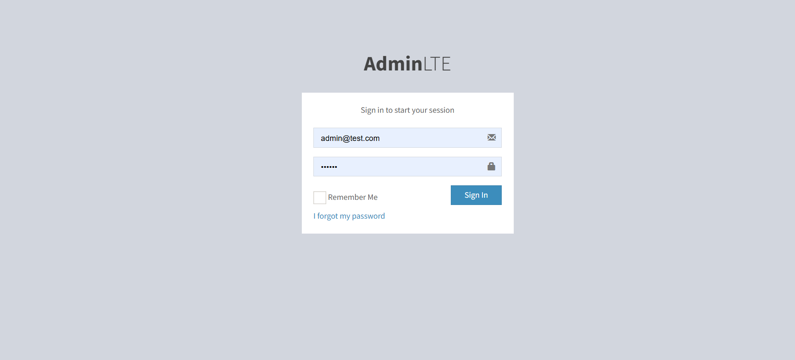
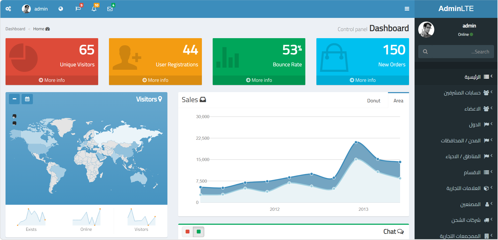
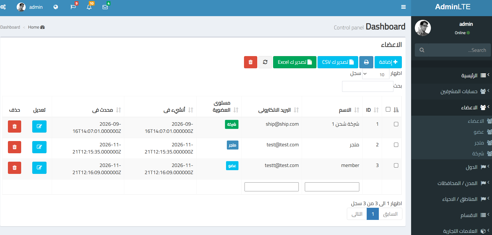
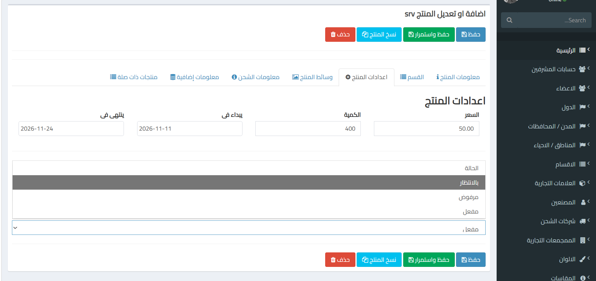

<div align="center">

# Ecommerce Management System

**A Laravel application for managing an online store through a dedicated administration panel.**


</div>

---

## About the Project

Ecommerce is a Laravel-based application that provides an administration panel for managing the main data and operations of an online store. The project includes dedicated administrator authentication, catalog management, product editing and media handling, user and location management, store settings, and Arabic/English localization.

The application also contains a storefront interface built with the Ustora theme. The current public home page renders the theme view, while the main implemented management workflows are available through the admin panel.

## Features

### Administrator Authentication

- Dedicated `admin` guard and Eloquent provider.
- Administrator login and logout.
- Protected admin routes through custom middleware.
- Login rate limiting.
- Forgot-password and password-reset workflow.

### Product Management

- Create product records and edit product details.
- Manage product information such as title, description, department, trademark, manufacturer, price, stock, dates, offer details, and status.
- Upload, replace, and remove the main product image.
- Upload and delete additional product files.
- Duplicate products together with their associated media and related records.
- Associate products with malls and related products.
- Search for products when managing related products.
- Load available sizes and weights based on the selected department.
- Delete individual products or perform bulk deletion.

### Catalog Management

The administration panel provides management pages for:

- Departments and parent/child department relationships.
- Trademarks.
- Manufacturers.
- Colors.
- Sizes.
- Weights.
- Malls.
- Shipping methods.

### Users and Locations

- User management.
- Country management.
- City management.
- State/area management.

### Store Configuration

- Arabic and English store names.
- Store logo and icon.
- Store description and keywords.
- Main language selection.
- Store availability status.
- Maintenance message and maintenance page handling.

### Data Tables

- Yajra Laravel DataTables integration.
- Eloquent-based server-side data tables.
- Search, pagination, and column filtering.
- Row selection and bulk actions.
- CSV, Excel, and print export buttons where configured.

### Localization

- Arabic and English translation files.
- Language switching from the admin panel.
- RTL layout for Arabic and LTR layout for English.
- Localized admin interface and DataTables messages.

## Technology Stack

| Technology | Usage |
|---|---|
| PHP 8.3+ | Backend language |
| Laravel 13 | Application framework |
| MySQL / MariaDB | Relational database |
| Blade | Server-rendered views |
| Eloquent ORM | Database models and relationships |
| Yajra Laravel DataTables 13 | Admin data tables |
| Maatwebsite Excel 4 | Excel export integration |
| JavaScript and jQuery | Frontend interactions |
| AdminLTE 2 | Admin dashboard template |
| Bootstrap 3 | Admin interface styling |
| Ustora | Storefront theme |

## Project Structure

```text
Ecommerce/
├── app/
│   ├── DataTables/              # Yajra DataTables classes
│   ├── Http/
│   │   ├── Controllers/Admin/   # Admin panel controllers
│   │   ├── Middleware/          # Admin, language, maintenance middleware
│   │   └── helper.php           # Shared helper functions
│   └── Models/                  # Eloquent models
├── bootstrap/
│   └── app.php                  # Application and middleware configuration
├── config/                      # Laravel configuration
├── database/
│   ├── migrations/              # Database schema
│   └── seeders/                 # Database seeders
├── public/
│   └── design/                  # AdminLTE and Ustora assets
├── resources/
│   └── views/
│       ├── admin/                # Admin Blade views
│       └── style/                # Storefront Blade views
├── routes/
│   ├── admin.php                # Admin panel routes
│   ├── console.php              # Console routes
│   └── web.php                  # Public web routes
├── composer.json
└── README.md
```

## Requirements

- PHP **8.3 or later**.
- Composer.
- MySQL or MariaDB.
- PHP extensions required by Laravel 13 and the installed Composer packages.

## Installation

### 1. Clone the repository

```bash
git clone https://github.com/MohammedNader2006/Admin-Ecommerce-.git
cd Admin-Ecommerce-
```

### 2. Install PHP dependencies

```bash
composer install
```

### 3. Configure the application

Create the local Laravel environment configuration from the example file:

**Windows PowerShell**

```powershell
Copy-Item .env.example .env
```

**macOS / Linux**

```bash
cp .env.example .env
```

Generate the application key:

```bash
php artisan key:generate
```

### 4. Configure the database

Create a MySQL or MariaDB database, then set the connection values in your local environment configuration. For example:

```.env
DB_CONNECTION=mysql
DB_HOST=127.0.0.1
DB_PORT=3306
DB_DATABASE=ecommerce
DB_USERNAME=root
DB_PASSWORD=
```

Use the database name, username, password, and port configured on your machine.

### 5. Run database migrations

```bash
php artisan migrate
```

### 6. Create an administrator account

The included `DatabaseSeeder` creates a regular test user; it does not create an admin account. Create the first administrator using Tinker:

```bash
php artisan tinker
```

Then execute:

```php
\App\Models\Admin::create([
    'name' => 'Administrator',
    'email' => 'admin@example.com',
    'password' => \Illuminate\Support\Facades\Hash::make('your-password'),
]);
```

Replace the sample email and password with your preferred credentials.

### 7. Run the application

```bash
php artisan serve
```

Open the local address shown by Artisan, usually `http://127.0.0.1:8000`.

## Main Routes

| Area | URL |
|---|---|
| Storefront home | `/` |
| Admin login | `/admin/login` |

## Mail Configuration

The password-reset workflow uses Laravel's mail system. Configure a working mail transport in the application environment settings to send password-reset emails.

## Project Scope

This README describes functionality found in the current routes, controllers, models, migrations, and views.

The public home route currently renders the Ustora storefront view. The current source does not implement complete customer-facing workflows for dynamic product browsing, shopping cart, checkout, payment processing, or order management; these are not presented as completed features.

---

## Screenshots










## Author

**Mohammed Nader**

- GitHub: [@MohammedNader2006](https://github.com/MohammedNader2006)
- Project Repository: [Admin-Ecommerce-](https://github.com/MohammedNader2006/Admin-Ecommerce-)
